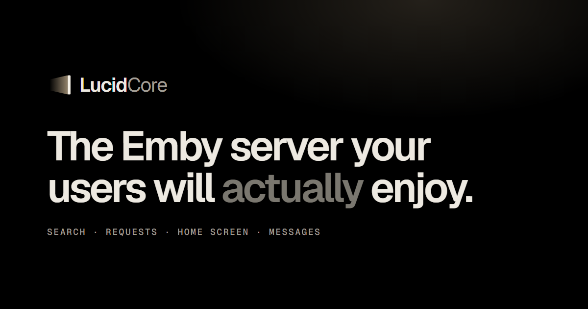

  

  <a href="https://lucidcore.tv">Website</a> ·
  <a href="docs/README.md">Docs</a> ·
  <a href="https://lucidcore.tv/pricing">Pricing</a> ·
  <a href="https://github.com/Chesyre/LucidCore/releases/latest">Download</a> ·
  <a href="CHANGELOG.md">Changelog</a>

# LucidCore

A plugin for Emby Server. Find titles in your library, manage requests from Emby and show recommendations for each person. One plugin, nothing to install in the apps.

**Free plan**, with a free license key and no email needed:

- LucidSearch and LucidPush, unlimited
- 5 Seerr requests and 5 LucidFlow sorts / month
- 1 LucidTop row
- 1 Emby server, unlimited users and devices

## Features

- **[LucidSearch](docs/lucidsearch.md): find your titles in more languages, at lightning speed.**
  Find films and shows in your library by their alternative names, in the languages you choose. Results come from a fast index on your server.
- **[LucidPush](docs/lucidpush.md): on-screen messages, controllable by API and rules.**
  Pop-up messages in the Emby apps, sent by rules you set or straight from your own scripts through its API.
- **[Seerr requests](docs/seerr-integration.md): send requests without leaving the Emby app.**
  Search can show title information outside your library. Press the heart to send a request to your Seerr request manager.
- **[LucidTop](docs/lucidtop.md): recommendations for each person, with TMDB integration.**
  A Recommended for you row for each person on the home screen, plus trending and top rated rows from your own library.
- **[LucidFlow](docs/lucidflow.md): requests sorted by AI to the right server.**
  An AI sorts Seerr requests between your connected servers, using your descriptions. It handles requests from Emby and Seerr.

## Requirements

- Emby Server 4.10 or newer, on Windows or Linux (Docker included). Not macOS.
- Nothing to install in the Emby apps. Only the old Emby app for Android TV is partly compatible.
- No Emby Premiere needed: LucidCore works on its own, with or without Premiere.

## Install

1. Download [LucidCore.dll](https://github.com/Chesyre/LucidCore/releases/latest/download/LucidCore.dll) and put it in Emby’s plugins folder.
2. Restart Emby, then paste your license key from [lucidcore.tv](https://lucidcore.tv) in the plugin and select Verify License.
3. Switch on the features you want, save and restart Emby.

The [install guide](docs/installation.md) walks you through each step, with the usual folder locations for Windows, Linux and Docker.

## Plans

Paid plans raise the monthly allowances and the number of servers: see [Pricing](https://lucidcore.tv/pricing).

## Your library

- **Never touched:** no files, Emby metadata or database entries are edited. Switch a feature off and Emby works as before.
- **Stays on your server:** lucidcore.tv does not receive your watch history or library list. Seerr and LucidFlow use the data explained in their docs.
- LucidCore doesn’t provide films or shows: use it with content you have the right to use.

## Help

- [Troubleshooting](docs/troubleshooting.md): the most common problems, feature by feature.
- [FAQ](https://lucidcore.tv/faq): compatibility, plans, privacy.
- Found a bug or have an idea? [Open an issue](https://github.com/Chesyre/LucidCore/issues/new/choose). Never paste your license key in an issue.
- Your account, a payment or anything private: [contact form](https://lucidcore.tv/contact).

Independent plugin. Not affiliated with Emby.
